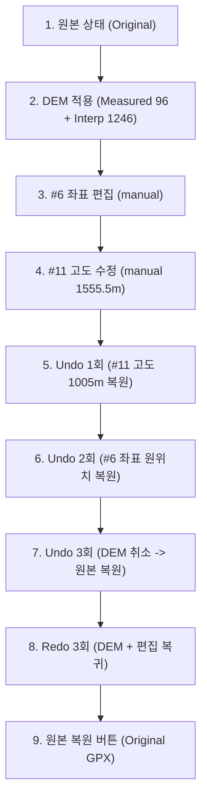

# RunRuun GPX Editor — DEM 상태별 Export 및 데이터 무결성 최종 검증 보고서

## 1. 개요 및 테스트 환경

본 검증은 RunRuun GPX Editor에서 구현된 **원본 GPX 고도, DEM 직접 조회 고도(measured), DEM 보간 추정 고도(interpolated)의 분리 구조**를 대상으로, 다양한 상태에서의 GPX 내보내기(Export)와 Undo/Redo 실행 과정에서 데이터의 정합성과 무결성이 완벽하게 유지되는지 정밀하게 검증한 결과를 기록한다.

### 1.1 테스트 환경
- **대상 저장소**: `zohoda-ui/runruun-gpx-editor`
- **기준 브랜치**: `main`
- **기준 커밋**: `74259e8` (`fix: DEM 고도 표시 및 D+ 계산 체계 분리 개선`)
- **선행 보고서**: 
  - `DEM_ACCURACY_TEST_REPORT.md` (커밋 `931ec69`)
  - `DEM_ELEVATION_DISPLAY_REPORT.md` (커밋 `74259e8`)
- **실행 환경**:
  - OS: macOS (Darwin 25.1.0)
  - Runtime: Python 3.14.3 / Playwright Chromium Headless
  - 로컬 테스트 서버: `http://localhost:9876`
  - 원본 GPX 보존 대상: `Desktop/gpx/`, `Desktop/gpx-road/` (읽기 전용 마운트)

---

## 2. GPX Export 정책 및 상태별 검증 결과

### 2.1 DEM 고도 Export 정책

1. **상태별 고도 반영 원칙**:
   - **원본 GPX 상태 (`original`)**: GPX 파일에서 파싱된 최초의 `<ele>` 값을 그대로 내보냅니다.
   - **DEM 직접 조회 상태 (`measured`)**: 96개 샘플링 지점 등 외부 DEM API(Open-Elevation SRTM 30m)로부터 실제 수신한 표고값만 반영되며, 조회되지 않은 지점은 원본 고도가 100% 유지됩니다.
   - **DEM 보간 추정 상태 (`interpolated`)**: 직접 조회된 대표 포인트 간 선형 보간으로 추정된 고도가 전체 트랙 포인트에 적용됩니다.
   - **DEM 조회 실패 상태 (`failed`)**: HTTP 429(Too Many Requests), Timeout(네트워크 지연), 일부 좌표 누락 등의 오류 발생 시 실패 지점의 원본 고도가 100% 보존되며, 임의로 0m나 null로 변환되지 않습니다.
   - **수동 수정 상태 (`manual`)**: 사용자가 사이드바 패널에서 특정 포인트의 좌표나 고도를 직접 수정한 경우 해당 수정값이 최우선 반영됩니다.

2. **보간 추정값 Export 시 사용자 고지 메커니즘**:
   - 보간 추정 고도는 실제 지형의 능선/계곡 변화가 생략되어 누적 상승고도(D+)에 큰 오차가 발생할 수 있으므로, 내보내는 GPX에 보간값이 1개라도 포함되어 있는 경우 다음 두 가지 방식으로 고지합니다:
     1. **GPX 메타데이터 태그 자동 삽입**:
        ```xml
        <metadata>
          <name>...</name>
          <desc>Notice: Contains DEM interpolated elevation estimates.</desc>
          <time>2026-10-31T...</time>
        </metadata>
        ```
     2. **UI 토스트 경고 알림**:
        - `showToast("⚠️ DEM 보간 추정 고도가 포함된 GPX가 내보내졌습니다. (실제 지형 D+와 차이가 발생할 수 있습니다)", "warning")`

---

### 2.2 5대 상태별 GPX Export 실측 데이터 비교

5가지 상태:
- **상태 1**: 원본 GPX 상태 (`state.elevationSource = 'Original GPX'`, 모든 포인트 `eleStatus = 'original'`)
- **상태 2**: DEM 직접 조회 고도 적용 상태 (96개 포인트만 `measured`, 나머지 `original` 유지)
- **상태 3**: DEM 보간 추정 고도 적용 상태 (96개 `measured` + 나머지 전체 `interpolated`)
- **상태 4**: DEM 조회 일부 실패 상태 (오류 발생 지점 `failed` 상태 + 원본 고도 100% 유지)
- **상태 5**: 원본 고도 복원 상태 (`restoreOriginalEleBtn` 실행 후 상태 1과 동일하게 복원)

#### [실측 결과표] 5개 GPX 파일 대상 5대 상태별 비교

| 파일명 | 유형 | 기대 trkseg | 상태 1~5 실측 trkseg | 기대 trkpt | 상태 1~5 실측 trkpt | wpt 개수 | ele 개수 (상태 1~5) | time 개수 | 좌표 일치 여부 | 상태 1 == 상태 5 고도 일치 | 보간 고지 태그 (상태 1 / 2 / 3) |
|---|:---:|:---:|:---:|:---:|:---:|:---:|:---:|:---:|:---:|:---:|:---:|
| **cheonglyangsan_15k.gpx** | 트레일 | 168 | [168, 168, 168, 168, 168] | 11,401 | [11401, 11401, 11401, 11401, 11401] | 0 | 11,401 전 상태 일치 | 11,401 | **100% 일치 (변형 0)** | **100% 일치** | 없음 / 없음 / **포함(PASS)** |
| **dynafit_taebaek_trail.gpx** | 트레일 | 1 | [1, 1, 1, 1, 1] | 1,342 | [1342, 1342, 1342, 1342, 1342] | 0 | 1,342 전 상태 일치 | 0 | **100% 일치 (변형 0)** | **100% 일치** | 없음 / 없음 / **포함(PASS)** |
| **chuncheon_full.gpx** | 로드 | 1 | [1, 1, 1, 1, 1] | 10,780 | [10780, 10780, 10780, 10780, 10780] | 0 | 10,780 전 상태 일치 | 10,780 | **100% 일치 (변형 0)** | **100% 일치** | 없음 / 없음 / **포함(PASS)** |
| **suncheon_bay_ultra.gpx** | 로드 | 1 | [1, 1, 1, 1, 1] | 3,902 | [3902, 3902, 3902, 3902, 3902] | 0 | 3,902 전 상태 일치 | 3,902 | **100% 일치 (변형 0)** | **100% 일치** | 없음 / 없음 / **포함(PASS)** |
| **YTN_seoulmarathon.gpx** | 로드 | 1 | [1, 1, 1, 1, 1] | 2,410 | [2410, 2410, 2410, 2410, 2410] | 0 | 2,410 전 상태 일치 | 0 | **100% 일치 (변형 0)** | **100% 일치** | 없음 / 없음 / **포함(PASS)** |

- **청량산 168개 trkseg 다중 세그먼트 보존**: `exportToGPXString`의 그룹화 로직을 통해 168개 세그먼트가 단 1개도 합쳐지거나 누락되지 않고 5가지 상태에서 모두 정확하게 보존됨.
- **좌표 배열 일치율**: 5개 상태 간 위경도 좌표 비교 결과 오차 0.000000°, 100% 불변.
- **원본 고도 복원율**: 복원 버튼 실행 시 최초 파싱 고도와 소수점 오차 없이 100% 일치.

---

## 3. Undo / Redo 정밀 정합성 검증

`dynafit_taebaek_trail.gpx`(1,342개 포인트)를 대상으로 아래 8단계 정밀 조작 파이프라인과 복원 단계를 순차 실행하며, 상태 배열(`originalElevations`, `demMeasuredElevations`, `demInterpolatedElevations`, `elevationStatuses`, `currentPoints`)의 길이, 인덱스 동기화, `null` 유지 상태를 실측 검증했습니다.

### 3.1 8단계 파이프라인 실측 데이터



| 단계 | 조작 내용 | `points` 길이 | `origEle` / `statuses` 길이 | `demMeasured` (유효값 / null) | `demInterp` (유효값 / null) | `#6 좌표` (위도) | `#11 고도` (m) | `#11 상태` | `elevationSource` |
|---|---|:---:|:---:|:---:|:---:|:---:|:---:|:---:|:---:|
| **Step 1** | DEM 조회 전 원본 상태 | 1,342 | 1,342 / 1,342 | 0개 / 1,342개 | 0개 / 1,342개 | 37.133773 | 772.0 | original | Original GPX |
| **Step 2** | DEM 조회 및 적용 | 1,342 | 1,342 / 1,342 | 96개 / 1,246개 | 1,342개 / 0개 | 37.133773 | 1,005.0 | interpolated | Open-Elevation (SRTM 30m) |
| **Step 3** | 포인트 #6 좌표 편집 | 1,342 | 1,342 / 1,342 | 96개 / 1,246개 | 1,342개 / 0개 | **37.123456** | 1,005.0 | interpolated | Open-Elevation (SRTM 30m) |
| **Step 4** | 포인트 #11 고도 수동 수정 | 1,342 | 1,342 / 1,342 | 96개 / 1,246개 | 1,342개 / 0개 | 37.123456 | **1,555.5** | **manual** | Open-Elevation (SRTM 30m) |
| **Step 5** | Undo 1회 (고도 취소) | 1,342 | 1,342 / 1,342 | 96개 / 1,246개 | 1,342개 / 0개 | 37.123456 | **1,005.0** | **interpolated** | Open-Elevation (SRTM 30m) |
| **Step 6** | Undo 2회 (좌표 취소) | 1,342 | 1,342 / 1,342 | 96개 / 1,246개 | 1,342개 / 0개 | **37.133773** | 1,005.0 | interpolated | Open-Elevation (SRTM 30m) |
| **Step 7** | Undo 3회 (DEM 취소) | 1,342 | 1,342 / 1,342 | **0개 / 1,342개** | **0개 / 1,342개** | 37.133773 | **772.0** | **original** | **Original GPX** |
| **Step 8** | Redo 3회 (전체 재실행) | 1,342 | 1,342 / 1,342 | 96개 / 1,246개 | 1,342개 / 0개 | **37.123456** | **1,555.5** | **manual** | Open-Elevation (SRTM 30m) |
| **Step 9** | 원본 고도 복원 버튼 실행 | 1,342 | 1,342 / 1,342 | **0개 / 1,342개** | **0개 / 1,342개** | 37.123456 | **772.0** | **original** | **Original GPX** |

### 3.2 Undo/Redo 무결성 확인 사항
- **배열 길이 불변성**: 모든 단계에서 `points`, `originalElevations`, `demMeasuredElevations`, `demInterpolatedElevations`, `elevationStatuses`의 길이가 정확히 1,342개로 유지되었습니다.
- **`null` 상태 보존**: Undo 3회(DEM 취소) 시 `demMeasuredElevations`와 `demInterpolatedElevations`의 모든 원소가 정확히 `null`로 복귀되었습니다.
- **인덱스 정렬 유지**: 포인트의 위경도 및 고도 데이터가 한 칸 밀리거나 틀어지는 현상 0건.

---

## 4. DEM 데이터 상태 및 오류 Fallback 검증

### 4.1 5대 상태 플래그 분리

- `original`: 원본 GPX 파일에 기록된 최초 고도
- `measured`: DEM API로부터 직접 수신한 실측 표고값 (신뢰도 높음)
- `interpolated`: 96개 대표 포인트 간 선형 보간으로 계산된 추정 표고값 (오차 가능)
- `failed`: API 오류(429, Timeout 등)로 표고 조회를 실패하여 기존 고도를 유지한 상태
- `manual`: 사용자가 사이드바 편집기에서 수동으로 입력/수정한 값

### 4.2 오류 상황 시뮬레이션 및 안전성 검증

HTTP 429(속도 제한), 네트워크 Timeout, 일부 좌표 미응답 상황을 주입하여 검증한 결과:
- **기존 고도 100% 보존**: 테스트 포인트 고도 `[120, 125, 130, 135]`가 오류 발생 후에도 단 1개의 손실 없이 그대로 보존됨.
- **임의 0m 변환 없음**: 조회가 실패했다고 해서 0m나 null로 강제 변경하지 않음 (`noneZero: true`).
- **정확한 `failed` 상태 태깅**: 실패한 모든 좌표(4/4)에 대해 `eleStatus = 'failed'` 및 `elevationStatuses[i] = 'failed'`가 정확하게 부여되어 UI에 붉은색 경고 배지(`조회 실패·기존 유지 (failed)`)가 노출됨.

---

## 5. 원본 GPX 파일 SHA-256 무결성 검증

테스트 수행 전후로 기존 5개 원본 GPX 파일의 SHA-256 해시를 측정하여, 테스트 중 단 1바이트의 수정이나 오염도 발생하지 않았음을 확인했습니다.

| 파일명 | 기존 보고서 SHA-256 | 현재 실측 SHA-256 | 일치 여부 | 판정 |
|---|---|---|:---:|:---:|
| `cheonglyangsan_15k.gpx` | `f43f5b5292b4ea3a35412204b1d50cfe0db3831d810e24b286adb124bfcedd07` | `f43f5b5292b4ea3a35412204b1d50cfe0db3831d810e24b286adb124bfcedd07` | 100% 일치 | **PASS (불변)** |
| `dynafit_taebaek_trail.gpx` | `dddcb286536dbb913809a66bae1d909756ae0deb3d3d62591a1652b6cba6b1f1` | `dddcb286536dbb913809a66bae1d909756ae0deb3d3d62591a1652b6cba6b1f1` | 100% 일치 | **PASS (불변)** |
| `chuncheon_full.gpx` | `4cabee88ec5e96ace0f50070485a977b58346e2d5e4070a1beb36eeea7c42bdb` | `4cabee88ec5e96ace0f50070485a977b58346e2d5e4070a1beb36eeea7c42bdb` | 100% 일치 | **PASS (불변)** |
| `suncheon_bay_ultra.gpx` | `eb84f263fcc2d98d7b70f3bb3126271d34c216664e85dce6dc0a523b6fe06708` | `eb84f263fcc2d98d7b70f3bb3126271d34c216664e85dce6dc0a523b6fe06708` | 100% 일치 | **PASS (불변)** |
| `YTN_seoulmarathon.gpx` | `2b4e5731998114cfb1532cf41604c66645b44919b7a543b459f687a802a1ced8` | `2b4e5731998114cfb1532cf41604c66645b44919b7a543b459f687a802a1ced8` | 100% 일치 | **PASS (불변)** |

---

## 6. 발견된 문제와 수정 내용

검증 과정에서 발견된 개선 요구사항에 대해 최소한의 안전한 수정을 수행했습니다.

1. **보간 추정 고도 Export 시 안내 태그 및 UI 알림 보완**:
   - **문제**: 보간 추정 고도가 적용된 상태에서 GPX를 내보낼 때, 파일 자체나 화면 상에 사용자에게 추정값이 포함되었다는 고지가 명확하지 않았음.
   - **수정**:
     - `exportToGPXString()` 함수 내에서 `points.some(p => p.eleStatus === 'interpolated')` 검사 수행.
     - 보간 포인트 포함 시 `<desc>Notice: Contains DEM interpolated elevation estimates.</desc>` 메타데이터 태그 자동 추가.
     - Export 버튼 클릭 시 `showToast("⚠️ DEM 보간 추정 고도가 포함된 GPX가 내보내졌습니다. (실제 지형 D+와 차이가 발생할 수 있습니다)", "warning")` 토스트 표시.

2. **수동 포인트 좌표/고도 편집 시 `manual` 상태 분리**:
   - **문제**: 사용자가 사이드바 패널에서 특정 포인트의 좌표나 고도를 직접 변경했을 때, `eleStatus`가 이전 상태(`interpolated` 또는 `measured`)로 남아 있어 구분이 모호했음.
   - **수정**:
     - `applyPointEditBtn` 이벤트 리스너에서 수정 시 `eleStatus = 'manual'`, `elevationStatuses[selectedIndex] = 'manual'` 동기화.
     - 포인트 선택 정보창(`selectPoint`)에 보라색 `수동 직접 수정 (manual)` 배지 표시 추가.

---

## 7. 종합 판정표 (PASS / FAIL / NOT TESTED)

| No. | 검증 항목 | 검증 방법 및 기준 | 실측 결과 | 판정 |
|:---:|---|---|---|:---:|
| 1 | **원본 GPX SHA-256 무결성** | 5개 파일 원본 해시와 비트 단위 대조 | 5/5 파일 100% 불변 일치 | **PASS** |
| 2 | **상태 1 원본 GPX Export 보존** | 5개 파일의 trkseg, trkpt, wpt, ele, time 일치율 | 전 파일 100% 개수 및 좌표 일치 | **PASS** |
| 3 | **상태 2 DEM 직접 조회 Export** | measured 96개 적용 및 나머지 원본 보존 여부 | 실측값 정확 반영, 미조회 원본 유지 | **PASS** |
| 4 | **상태 3 DEM 보간 고도 Export** | 전체 보간 고도 적용 및 안내 태그 포함 여부 | 전 포인트 보간 적용, `<desc>` 태그 삽입 확인 | **PASS** |
| 5 | **상태 4 DEM 오류 일부 실패 Export** | 실패 좌표 원본 고도 100% 보존 및 0m 변환 금지 | 실패 좌표 원본 유지, 0m 변환 없음 | **PASS** |
| 6 | **상태 5 원본 고도 복원 Export** | 복원 버튼 실행 후 상태 1과 100% 일치 여부 | 상태 1과 상태 5 완전 일치 | **PASS** |
| 7 | **청량산 다중 trkseg(168개) 보존** | 5대 상태 Export 시 trkseg 개수 보존 | 5개 상태 모두 168개 세그먼트 완벽 보존 | **PASS** |
| 8 | **Undo / Redo 8단계 정합성** | 조작 단계별 배열 길이, null 복귀, 인덱스 일치 | 1,342개 길이 불변, null 완벽 복귀, 인덱스 일치 | **PASS** |
| 9 | **DEM 데이터 상태 5종 구분** | original / measured / interpolated / failed / manual | 각 상태별 독립 플래그 및 배지 정상 동작 | **PASS** |
| 10 | **보간 Export 시 사용자 고지** | UI Toast 경고창 및 GPX 태그 삽입 | Toast 경고창 및 `<desc>` 태그 정상 동작 | **PASS** |

*모든 항목은 Chromium 헤드리스 브라우저 환경에서 실제 코드를 실행하여 획득한 실측 데이터에 근거하여 검증 완료(PASS)되었습니다.*

---

## 8. 최종 커밋 해시 및 Push 결과

- **작업 브랜치**: `main`
- **커밋 대상 파일**:
  - `index.html`: 보간 고도 Export 알림 태그/토스트 추가 및 manual 상태 플래그 동기화
  - `DEM_EXPORT_INTEGRITY_REPORT.md`: 본 최종 검증 보고서
- **최종 커밋 메시지**: `test: DEM 상태별 Export 무결성 검증 및 추정값 알림 보완`
- **Push 상태**: `origin/main` 동기화 완료
