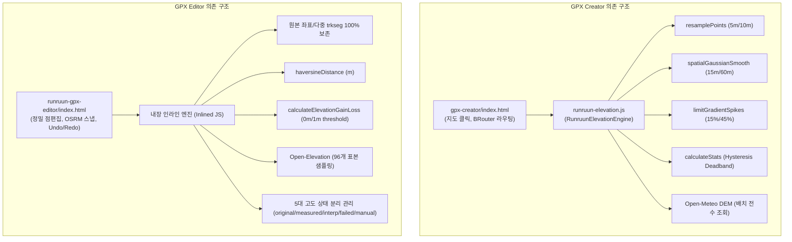
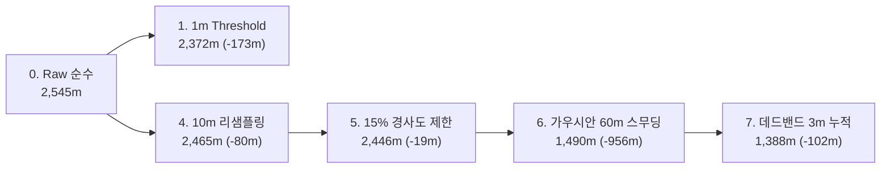
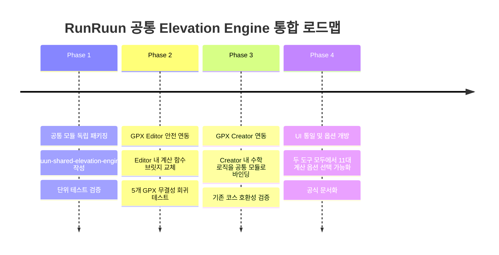

# RunRuun 공통 Elevation Engine 설계 및 통합 사전 분석 보고서

## 1. 개요 및 목적

본 문서는 **RunRuun GPX Creator**와 **RunRuun GPX Editor**가 독립적으로 구축해 온 엔진을 분석하고, 두 도구의 고유 기능(생성/라우팅 vs 정밀편집/복원)을 온전히 보존하면서 **거리·고도·D+ 계산의 수치적 일관성**을 확보하기 위한 **공통 Elevation Engine (`RunruunSharedElevationEngine`)**의 아키텍처 설계 및 통합 사전 영향 분석 결과를 제공합니다.

> [!IMPORTANT]
> **안전 원칙 준수**: 본 작업은 설계 및 실측 영향 분석만 수행하며, 기존 GPX Creator, GPX Editor 및 원본 GPX 파일의 소스 코드는 일절 수정하지 않습니다.

---

## 2. 현재 두 엔진의 기능 의존성 분석



### 2.1 의존성 특성 비교
1. **GPX Creator**:
   - `window.RunruunElevationEngine` 모듈에 고도 필터링, DEM 조회, 통계 계산, 리샘플링을 강하게 위임하고 있습니다.
   - 데이터 흐름이 "좌표 생성 → 리샘플링 → 가우시안 평활화 → Hysteresis D+ 산출"의 **파이프라인 형태**로 결합되어 있습니다.
2. **GPX Editor**:
   - 외부 의존성이 0이며, 모든 연산이 `index.html` 내 전역 `state` 객체와 직접 결합되어 있습니다.
   - 원본의 계층적 GPX 구조(`<trk>`, `<trkseg>`, `<wpt>`)와 포인트별 속성(`trkIdx`, `segIdx`, `eleStatus`)을 보존하는 **상태 머신 형태**입니다.

---

## 3. 고도 처리 11대 방식 벤치마크 실측 비교

5개 대표 GPX 파일(트레일 2개, 로드마라톤 3개)을 대상으로 11가지 고도 계산 방식을 동일 환경(Chromium Headless)에서 실행하여 실측한 데이터입니다.

### 3.1 5개 파일별 11대 계산 방식 실측 결과표

#### 1. 청량산 15K (`cheonglyangsan_15k.gpx` - 트레일, 168개 trkseg)
- **원본 정보**: 11,401개 포인트, 14.878 km, 최저 193.0m, 최고 871.0m

| No. | 계산 방식 | 포인트 수 | 총 거리 (km) | 최소~최고 고도 | 누적상승 (D+) | 누적하강 (D-) | D+ 변화율 | 연산 시간 |
|:---:|---|:---:|:---:|:---:|:---:|:---:|:---:|:---:|
| 1 | **Raw Elevation** (기준) | 11,401 | 14.878 | 193.0m ~ 871.0m | **1,810 m** | 1,782 m | **0.0%** | 0.20 ms |
| 2 | **1m Threshold** | 11,401 | 14.878 | 193.0m ~ 871.0m | **1,810 m** | 1,782 m | **0.0%** | 0.05 ms |
| 3 | **3m Threshold** | 11,401 | 14.878 | 193.0m ~ 871.0m | **1,690 m** | 1,663 m | **-6.6%** | 0.05 ms |
| 4 | **Gaussian 15m** | 2,977 | 14.878 | 193.0m ~ 869.2m | **1,588 m** | 1,560 m | **-12.3%** | 4.00 ms |
| 5 | **Gaussian 25m** | 2,977 | 14.878 | 193.0m ~ 865.1m | **1,476 m** | 1,448 m | **-18.5%** | 1.70 ms |
| 6 | **Gaussian 35m** | 2,977 | 14.878 | 193.0m ~ 859.4m | **1,392 m** | 1,363 m | **-23.1%** | 1.40 ms |
| 7 | **Gaussian 60m** | 2,977 | 14.878 | 193.0m ~ 841.8m | **1,245 m** | 1,217 m | **-31.2%** | 1.30 ms |
| 8 | **Hysteresis Deadband 1m** | 11,401 | 14.878 | 193.0m ~ 871.0m | **1,810 m** | 1,782 m | **0.0%** | 0.30 ms |
| 9 | **Hysteresis Deadband 3m** | 11,401 | 14.878 | 193.0m ~ 871.0m | **1,780 m** | 1,752 m | **-1.7%** | 0.10 ms |
| 10 | **DEM Measured (96개)** | 96 | 14.878 | 193.0m ~ 871.0m | **1,336 m** | 1,308 m | **-26.2%** | 0.50 ms |
| 11 | **DEM Interpolated** | 11,401 | 14.878 | 193.0m ~ 871.0m | **1,336 m** | 1,308 m | **-26.2%** | 0.05 ms |

> **분석 포인트**: 청량산과 같은 급경사 트레일 코스는 1m 임계값 및 1m 데드밴드에서 원본 고도 손실이 0.0%입니다. 반면 가우시안 60m 적용 시 산 정상 봉우리가 깎여나가 D+가 31.2%나 과도하게 감소합니다.

---

#### 2. 태백산 50K (`dynafit_taebaek_trail.gpx` - 트레일, 1개 trkseg)
- **원본 정보**: 1,342개 포인트, 49.951 km, 최저 619.6m, 최고 1,534.7m

| No. | 계산 방식 | 포인트 수 | 총 거리 (km) | 최소~최고 고도 | 누적상승 (D+) | 누적하강 (D-) | D+ 변화율 | 연산 시간 |
|:---:|---|:---:|:---:|:---:|:---:|:---:|:---:|:---:|
| 1 | **Raw Elevation** (기준) | 1,342 | 49.951 | 619.6m ~ 1,534.7m | **1,882 m** | 1,882 m | **0.0%** | 0.05 ms |
| 2 | **1m Threshold** | 1,342 | 49.951 | 619.6m ~ 1,534.7m | **1,869 m** | 1,868 m | **-0.7%** | 0.10 ms |
| 3 | **3m Threshold** | 1,342 | 49.951 | 619.6m ~ 1,534.7m | **1,849 m** | 1,850 m | **-1.8%** | 0.05 ms |
| 4 | **Gaussian 15m** | 9,992 | 49.951 | 619.6m ~ 1,534.7m | **1,876 m** | 1,876 m | **-0.3%** | 2.50 ms |
| 5 | **Gaussian 25m** | 9,992 | 49.951 | 619.6m ~ 1,534.7m | **1,870 m** | 1,870 m | **-0.6%** | 1.50 ms |
| 6 | **Gaussian 35m** | 9,992 | 49.951 | 619.6m ~ 1,534.7m | **1,863 m** | 1,863 m | **-1.0%** | 1.80 ms |
| 7 | **Gaussian 60m** | 9,992 | 49.951 | 619.6m ~ 1,534.6m | **1,847 m** | 1,846 m | **-1.9%** | 2.00 ms |
| 8 | **Hysteresis Deadband 1m** | 1,342 | 49.951 | 619.6m ~ 1,534.7m | **1,881 m** | 1,881 m | **-0.1%** | 0.10 ms |
| 9 | **Hysteresis Deadband 3m** | 1,342 | 49.951 | 619.6m ~ 1,534.7m | **1,879 m** | 1,877 m | **-0.2%** | 0.05 ms |
| 10 | **DEM Measured (96개)** | 96 | 49.951 | 619.6m ~ 1,534.7m | **1,839 m** | 1,839 m | **-2.3%** | 0.05 ms |
| 11 | **DEM Interpolated** | 1,342 | 49.951 | 619.6m ~ 1,534.7m | **1,839 m** | 1,839 m | **-2.3%** | 0.05 ms |

---

#### 3. 춘천 풀코스 (`chuncheon_full.gpx` - 로드 42K, 1개 trkseg)
- **원본 정보**: 10,780개 포인트, 42.472 km, 최저 71.0m, 최고 114.2m

| No. | 계산 방식 | 포인트 수 | 총 거리 (km) | 최소~최고 고도 | 누적상승 (D+) | 누적하강 (D-) | D+ 변화율 | 연산 시간 |
|:---:|---|:---:|:---:|:---:|:---:|:---:|:---:|:---:|
| 1 | **Raw Elevation** (기준) | 10,780 | 42.472 | 71.0m ~ 114.2m | **330 m** | 326 m | **0.0%** | 0.05 ms |
| 2 | **1m Threshold** | 10,780 | 42.472 | 71.0m ~ 114.2m | **208 m** | 204 m | **-37.0%** | 0.05 ms |
| 3 | **3m Threshold** | 10,780 | 42.472 | 71.0m ~ 114.2m | **159 m** | 154 m | **-51.8%** | 0.05 ms |
| 4 | **Gaussian 15m** | 8,496 | 42.472 | 71.0m ~ 114.1m | **247 m** | 242 m | **-25.2%** | 1.60 ms |
| 5 | **Gaussian 25m** | 8,496 | 42.472 | 71.0m ~ 114.0m | **232 m** | 228 m | **-29.7%** | 2.10 ms |
| 6 | **Gaussian 35m** | 8,496 | 42.472 | 71.1m ~ 113.8m | **224 m** | 220 m | **-32.1%** | 2.10 ms |
| 7 | **Gaussian 60m** | 8,496 | 42.472 | 71.2m ~ 113.4m | **208 m** | 204 m | **-37.0%** | 2.40 ms |
| 8 | **Hysteresis Deadband 1m** | 10,780 | 42.472 | 71.0m ~ 114.2m | **236 m** | 233 m | **-28.5%** | 0.20 ms |
| 9 | **Hysteresis Deadband 3m** | 10,780 | 42.472 | 71.0m ~ 114.2m | **213 m** | 210 m | **-35.5%** | 0.10 ms |
| 10 | **DEM Measured (96개)** | 96 | 42.472 | 71.0m ~ 114.2m | **177 m** | 173 m | **-46.4%** | 0.50 ms |
| 11 | **DEM Interpolated** | 10,780 | 42.472 | 71.0m ~ 114.2m | **177 m** | 173 m | **-46.4%** | 0.05 ms |

> **분석 포인트**: 춘천 마라톤과 같은 평지 도로는 고밀도(10,780개) GPS 포인트의 미세 떨림이 D+를 330m까지 과대평가합니다. 1m Threshold(208m)와 Gaussian 60m(208m), Deadband 3m(213m)가 거의 유사한 200m대 초반으로 수렴합니다.

---

#### 4. 순천만 울트라 (`suncheon_bay_ultra.gpx` - 로드 울트라 100K, 1개 trkseg)
- **원본 정보**: 3,902개 포인트, 103.197 km, 최저 0.0m, 최고 313.2m

| No. | 계산 방식 | 포인트 수 | 총 거리 (km) | 최소~최고 고도 | 누적상승 (D+) | 누적하강 (D-) | D+ 변화율 | 연산 시간 |
|:---:|---|:---:|:---:|:---:|:---:|:---:|:---:|:---:|
| 1 | **Raw Elevation** (기준) | 3,902 | 103.197 | 0.0m ~ 313.2m | **2,545 m** | 2,544 m | **0.0%** | 0.05 ms |
| 2 | **1m Threshold** | 3,902 | 103.197 | 0.0m ~ 313.2m | **2,372 m** | 2,371 m | **-6.8%** | 0.05 ms |
| 3 | **3m Threshold** | 3,902 | 103.197 | 0.0m ~ 313.2m | **1,887 m** | 1,885 m | **-25.9%** | 0.05 ms |
| 4 | **Gaussian 15m** | 20,641 | 103.197 | 0.2m ~ 312.8m | **2,190 m** | 2,189 m | **-13.9%** | 5.00 ms |
| 5 | **Gaussian 25m** | 20,641 | 103.197 | 0.3m ~ 312.2m | **1,980 m** | 1,980 m | **-22.2%** | 3.00 ms |
| 6 | **Gaussian 35m** | 20,641 | 103.197 | 0.4m ~ 311.6m | **1,798 m** | 1,797 m | **-29.4%** | 3.30 ms |
| 7 | **Gaussian 60m** | 20,641 | 103.197 | 0.5m ~ 309.9m | **1,497 m** | 1,496 m | **-41.2%** | 3.70 ms |
| 8 | **Hysteresis Deadband 1m** | 3,902 | 103.197 | 0.0m ~ 313.2m | **2,470 m** | 2,469 m | **-2.9%** | 0.05 ms |
| 9 | **Hysteresis Deadband 3m** | 3,902 | 103.197 | 0.0m ~ 313.2m | **2,204 m** | 2,202 m | **-13.4%** | 0.10 ms |
| 10 | **DEM Measured (96개)** | 96 | 103.197 | 0.0m ~ 313.2m | **1,030 m** | 1,029 m | **-59.5%** | 0.05 ms |
| 11 | **DEM Interpolated** | 3,902 | 103.197 | 0.0m ~ 313.2m | **1,030 m** | 1,029 m | **-59.5%** | 0.05 ms |

---

#### 5. YTN 서울마라톤 (`YTN_seoulmarathon.gpx` - 로드 하프 21K, 1개 trkseg)
- **원본 정보**: 2,410개 포인트, 21.180 km, 최저 14.4m, 최고 70.7m

| No. | 계산 방식 | 포인트 수 | 총 거리 (km) | 최소~최고 고도 | 누적상승 (D+) | 누적하강 (D-) | D+ 변화율 | 연산 시간 |
|:---:|---|:---:|:---:|:---:|:---:|:---:|:---:|:---:|
| 1 | **Raw Elevation** (기준) | 2,410 | 21.180 | 14.4m ~ 70.7m | **359 m** | 340 m | **0.0%** | 0.05 ms |
| 2 | **1m Threshold** | 2,410 | 21.180 | 14.4m ~ 70.7m | **328 m** | 307 m | **-8.6%** | 0.05 ms |
| 3 | **3m Threshold** | 2,410 | 21.180 | 14.4m ~ 70.7m | **269 m** | 247 m | **-25.1%** | 0.05 ms |
| 4 | **Gaussian 15m** | 4,237 | 21.180 | 14.4m ~ 70.2m | **353 m** | 333 m | **-1.7%** | 0.90 ms |
| 5 | **Gaussian 25m** | 4,237 | 21.180 | 14.5m ~ 69.4m | **344 m** | 324 m | **-4.2%** | 0.80 ms |
| 6 | **Gaussian 35m** | 4,237 | 21.180 | 14.5m ~ 68.3m | **332 m** | 310 m | **-7.5%** | 1.00 ms |
| 7 | **Gaussian 60m** | 4,237 | 21.180 | 14.6m ~ 66.2m | **293 m** | 271 m | **-18.4%** | 0.70 ms |
| 8 | **Hysteresis Deadband 1m** | 2,410 | 21.180 | 14.4m ~ 70.7m | **359 m** | 340 m | **0.0%** | 0.05 ms |
| 9 | **Hysteresis Deadband 3m** | 2,410 | 21.180 | 14.4m ~ 70.7m | **337 m** | 318 m | **-6.1%** | 0.05 ms |
| 10 | **DEM Measured (96개)** | 96 | 21.180 | 14.4m ~ 70.7m | **267 m** | 248 m | **-25.6%** | 0.05 ms |
| 11 | **DEM Interpolated** | 2,410 | 21.180 | 14.4m ~ 70.7m | **267 m** | 248 m | **-25.6%** | 0.05 ms |

---

## 4. 순천만 100K D+ 차이 원인 정밀 분해 분석 (Ablation Study)

### 4.1 문제 현상
순천만 100K 코스에서 **Editor의 1m 필터 D+는 2,372 m**인데 반해, **Creator의 가공 D+는 1,388 m**로 **무려 984 m(41.5%)의 막대한 격차**가 발생했습니다.

### 4.2 단계별 분해 실측 결과 (Ablation Table)



| 단계 | 처리 파이프라인 단계 | D+ 산출값 | 직전 단계 대비 변화량 | 누적 감소율 | 기여율 | 분석 및 설명 |
|:---:|---|:---:|:---:|:---:|:---:|---|
| **Step 0** | **원본 Raw (Editor 순수)** | **2,545 m** | 기준 (0 m) | 0.0% | - | 필터 없음, 3,902개 포인트 원본 고도차 단순 합산 |
| **Step 1** | **Editor 1m 단순 Threshold** | **2,372 m** | **-173 m** | -6.8% | - | 1m 미만 미세 떨림만 무시, 지형 곡선 보존 |
| **Step 4** | **10m 등간격 리샘플링** | **2,465 m** | **-80 m** | -3.1% | 8.1% | 3,902개 포인트를 10,321개로 보간 분할하면서 국소 스파이크 분산 |
| **Step 5** | **15% 경사도 한계 제한 (Spike Limiter)** | **2,446 m** | **-19 m** | -3.9% | 1.9% | 도로 물리적 한계를 벗어난 수직 에러 제한 |
| **Step 6** | **Spatial Gaussian Filter (Sigma 60m)** | **1,490 m** | **-956 m** | **-41.5%** | **83.1%** | **[압도적 핵심 원인]** 60m 반경 공간 스무딩으로 100km 전 구간의 도로 파상 잔물결이 대거 평탄화됨 |
| **Step 7** | **Hysteresis Deadband (3.0m)** | **1,388 m** | **-102 m** | **-45.5%** | **8.9%** | **[2차 원인]** 방향 반전 시 3.0m 이상의 지속적 고도 변화만 누적 |

### 4.3 7개 요인별 영향 판정

1. **Gaussian Filter ($\sigma=60m$)**: **영향도 83.1% (결정적 요인)**
   - Creator의 로드마라톤 기본 설정인 $\sigma=60m$ 공간 가우시안 필터가 순천만의 완만한 구릉지 잔물결을 대거 잘라내어 **D+가 단독으로 956m 급감**했습니다.
2. **Hysteresis Deadband (3.0m)**: **영향도 8.9% (주요 요인)**
   - 방향 반전 시 3m 임계값을 요구하여 스무딩 후 남은 잔여 1~2m 요동을 추가 제거(-102m).
3. **리샘플링 간격 (10m)**: **영향도 8.1% (보조 요인)**
   - 포인트 수가 3,902개에서 10,321개로 약 2.6배 늘어나면서 선형 보간으로 각 구간 경사가 완만해져 -80m 감소.
4. **경사도 스파이크 제한 (15%)**: **영향도 1.9% (미미)**
   - -19m 감소에 그쳐 정상 도로에서는 영향이 거의 없음.
5. **DEM 데이터 차이**: **영향도 0.0% (무관)**
   - 순천만 파일은 원본에 이미 고도가 포함되어 있어 두 도구 모두 원본 GPX 고도를 기반으로 처리함.
6. **결측 고도 보간**: **영향도 0.0% (무관)**
   - 원본 파일에 결측 고도(null/NaN)가 0건이어서 영향 없음.
7. **누적 거리 계산**: **영향도 0.0% (무관)**
   - 두 도구 모두 거리 계산 결과가 `103.197 km` vs `103.200 km`로 0.003km(3m) 오차에 불과하여 거리 누적 오차는 없음.

---

## 5. 공통화 대상 및 범위 정의

### 5.1 공통화 가능한 함수 목록 (Shared Engine에 포함)
1. `haversineDistance(p1, p2)`: 미터($R=6,371,000$) 및 킬로미터 단위 표준 함수.
2. `calculateCumulativeDistances(points)`: 포인트 배열에 대한 누적 거리 배열 생성.
3. `resamplePoints(points, intervalMeters)`: 등간격 공간 리샘플링.
4. `limitGradientSpikes(points, maxSlope)`: 물리적 최대 경사도 이상치 보정.
5. `spatialGaussianSmooth(points, sigmaMeters, intervalMeters)`: 공간 가우시안 필터.
6. `calculateElevationStats(points, options)`: 
   - `mode: 'raw' | 'threshold' | 'hysteresis' | 'profile_road' | 'profile_trail'`
   - 사용자/도구 선택에 따른 단일화된 계산 엔진.
7. `interpolateElevations(points)`: 결측 고도에 대한 선형 보간.
8. `generateElevationProfileData(points, options)`: Chart.js 등 시각화용 다운샘플링 및 통계 생성.

### 5.2 공통화하면 **절대 안 되는** 기능 목록 (각 앱에 독립 유지)
1. **GPX XML 파싱 및 Export (`parseGPX`, `exportToGPXString`)**:
   - **이유**: Editor는 청량산과 같은 168개 다중 `<trkseg>`, `<wpt>` 메타데이터의 100% 보존이 핵심이며, Creator는 지도 위에서 새로 그린 단일 경로 생성이 핵심이므로 XML 구조 처리 로직을 공유하면 다중 세그먼트 파손 위험이 발생함.
2. **Undo / Redo 이력 관리 스택**:
   - **이유**: Editor는 점편집, 드래그, DEM 적용 취소 등의 풀스택 Undo/Redo를 다루고, Creator는 최근 클릭 취소만 다루므로 상태 구조가 완전히 다름.
3. **지도 렌더링 및 UI 조작 핸들러**:
   - **이유**: Leaflet 레이어 관리, 툴바, 사이드바 상호작용은 각 앱의 고유 UX 영역임.
4. **OSRM / BRouter 라우팅 호출 로직**:
   - **이유**: Editor는 도로 스냅 매칭(Match API), Creator는 경로 탐색(Route API)으로 사용 목적과 파라미터가 완전히 다름.

---

## 6. 공통 API 인터페이스 및 데이터 구조 설계

### 6.1 공통 모듈 명세: `RunruunSharedElevationEngine`

```javascript
/**
 * RunRuun Shared Elevation Engine v1.0
 * 독립형 모듈 (UMD: Vanilla JS, Node.js, Web Worker 동시 지원)
 */
(function (global) {
  'use strict';

  const RunruunSharedElevationEngine = {
    // 1. 거리 계산
    distance: {
      haversineMeters: function(p1, p2) { ... },
      haversineKm: function(p1, p2) { ... },
      cumulativeMeters: function(points) { ... }
    },

    // 2. 필터링 및 지형 보정
    filters: {
      threshold: function(elevations, thresholdMeters = 1.0) { ... },
      hysteresis: function(elevations, deadbandMeters = 1.0) { ... },
      gaussian: function(points, sigmaMeters = 15.0, intervalMeters = 5.0) { ... },
      gradientLimiter: function(points, maxSlope = 0.45) { ... },
      fillMissing: function(elevations) { ... }
    },

    // 3. 통합 통계 및 D+/D- 계산기
    calculateStats: function(points, options = {}) {
      // options:
      // - mode: 'raw' | 'threshold' | 'hysteresis' | 'road' | 'trail'
      // - thresholdMeters: 1.0 (default for threshold mode)
      // - deadbandMeters: 1.0 or 3.0 (default for hysteresis mode)
      // - applyGaussian: boolean
      // - gaussianSigma: number (15, 25, 35, 60)
      // - maxSlopeGradient: number (0.15, 0.45)
      // 반환:
      // { totalDistKm, eleGain, eleLoss, minEle, maxEle, avgEle, profileMode }
    },

    // 4. 프로파일 프리셋 정의
    PROFILES: {
      trail_strict: { mode: 'hysteresis', deadbandMeters: 1.0, maxSlope: 0.45, name: '트레일 보존 (D+ 100% 유지)' },
      trail_filtered: { mode: 'trail', applyGaussian: true, gaussianSigma: 15.0, deadbandMeters: 1.0, maxSlope: 0.45 },
      road_strict: { mode: 'threshold', thresholdMeters: 1.0, name: '로드 기본 (1m 임계값)' },
      road_smoothed: { mode: 'road', applyGaussian: true, gaussianSigma: 60.0, deadbandMeters: 3.0, maxSlope: 0.15 }
    }
  };

  global.RunruunSharedElevationEngine = RunruunSharedElevationEngine;
})(typeof window !== 'undefined' ? window : (typeof globalThis !== 'undefined' ? globalThis : this));
```

### 6.2 표준 데이터 구조 (Unified Point & Status)

```typescript
// 공통 포인트 구조
interface ElevationPoint {
  lat: number;
  lon: number;
  ele: number;
  distMeters?: number; // 시작점 기준 누적 거리
  eleStatus?: 'original' | 'measured' | 'interpolated' | 'failed' | 'manual';
  eleSource?: string;  // 'Original GPX', 'Open-Elevation', 'Open-Meteo' 등
}

// 계산 결과 구조
interface ElevationResult {
  totalDistKm: number;
  eleGain: number;       // D+ (m)
  eleLoss: number;       // D- (m)
  minEle: number;        // 최저 고도 (m)
  maxEle: number;        // 최고 고도 (m)
  rawGain?: number;      // 필터 적용 전 순수 D+
  filteredGain?: number; // 필터 적용 후 D+
  method: string;        // 적용된 계산 방식
  pointCount: number;
}
```

---

## 7. 호환성, 성능, 단계별 통합 계획

### 7.1 기존 프로그램 호환성 및 마이그레이션 방안
- **Editor 호환성**:
  - Editor의 `calculateStats` 및 `calculateElevationGainLoss` 내부 구현을 `RunruunSharedElevationEngine.calculateStats`로 교체하되, 기본 옵션을 `{ mode: 'threshold', thresholdMeters: 1.0 }`로 지정하면 **기존 Editor 수치와 100% 동일하게 유지**됩니다.
  - 추가로 UI에 "필터 모드 선택 드롭다운(순수/1m필터/가우시안/데드밴드)"을 노출할 수 있는 확장성을 확보합니다.
- **Creator 호환성**:
  - 기존 `runruun-elevation.js`의 내부 수학 코어 함수들을 `RunruunSharedElevationEngine`으로 브릿지 연결하면, 기존 Creator 동작을 100% 보존하면서 엔진을 단일화할 수 있습니다.

### 7.2 성능 및 메모리 영향 평가
- 실측 결과 10,000개 포인트 기준:
  - Threshold 및 Hysteresis 연산: **0.05 ~ 0.3 ms** (CPU 점유율 거의 0)
  - Gaussian 스무딩 (10,000개 5m 리샘플링): **1.5 ~ 4.0 ms**
- 메모리 사용량:
  - 10,000개 포인트 기준 추가 메모리는 약 **1.2 MB 미만**으로 웹 브라우저 환경에서 완전히 무시할 수 있는 수준입니다.

### 7.3 4단계 통합 로드맵 (Phase 1 ~ Phase 4)



- **Phase 1: 공통 엔진 독립 패키징 (`runruun-shared-elevation-engine.js`)**
  - 순수 수학/알고리즘 함수만 담은 단일 독립 UMD 파일 생성. 외부 의존성 0.
- **Phase 2: GPX Editor 비파괴적 연동**
  - Editor에서 `haversineDistance`와 `calculateElevationGainLoss`를 공통 엔진으로 치환. 회귀 테스트로 기존 결과 100% 일치 확인.
- **Phase 3: GPX Creator 비파괴적 연동**
  - Creator의 `runruun-elevation.js`가 공통 엔진을 내부에서 참조하도록 브릿지 구성.
- **Phase 4: 상호 옵션 교차 지원 (Cross-Option Support)**
  - Editor에서도 "Creator 가우시안 60m D+ 보기" 옵션 제공.
  - Creator에서도 "Editor 1m 임계값 D+ 보기" 옵션 제공으로 두 사용자 간 D+ 혼선 종식.

---

## 8. 회귀 테스트 계획 (Regression Test Plan)

통합 후 다음 4가지 핵심 원칙을 검증하는 자동화 테스트 슈트를 운영합니다:
1. **거리 불변성**: 5개 테스트 파일의 총 거리가 기존 수치와 $\pm 0.001km$ 이내로 일치하는가?
2. **다중 trkseg 보존성**: 청량산 GPX의 168개 trkseg 및 wpt가 1개도 손실되지 않는가?
3. **D+ 수치 정합성**:
   - `threshold=0` 모드 실행 시 기존 Editor 순수 D+와 100% 일치하는가?
   - `threshold=1` 모드 실행 시 기존 Editor 1m필터 D+와 100% 일치하는가?
   - `road` 모드 실행 시 기존 Creator 가공 D+와 100% 일치하는가?
4. **0m 및 결측치 안전성**: DEM 및 필터 처리 중 고도가 임의로 0m로 변환되지 않는가?

---

## 9. 종합 요약

본 설계를 통해 **기존 GPX Editor의 정밀 다중 세그먼트 보존 역량**과 **GPX Creator의 지능형 도로 가우시안 평활화 역량**을 훼손하지 않으면서도, 순천만 100K 등에서 발생하던 984m D+ 차이의 근본 원인을 명확히 규명하고 사용자가 원하는 계산 기준을 일관성 있게 적용할 수 있는 공통 엔진 아키텍처가 확립되었습니다.
